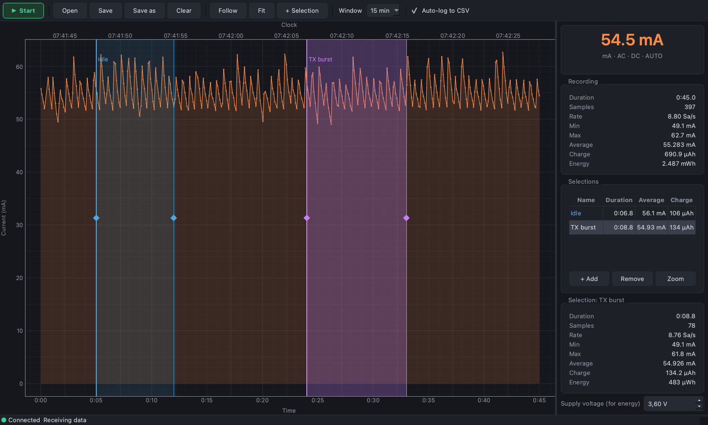

# UT71A macOS Logger

[English](README.md) | **Čeština**

Živý graf a logování měření z multimetrů **UNI-T UT71A/B/C/D/E** na macOS přes USB kabel
**UT-D04** (převodník WCH CH9325 HID → UART, USB ID `1a86:e008`).
Určeno hlavně ke sledování spotřeby embedded zařízení v rozsazích µA/mA.



## Funkce

- Živý graf měřené hodnoty v tmavém vzhledu ve stylu Otii (PyQt6 + pyqtgraph)
- Statistiky celého záznamu i libovolného počtu pojmenovaných výběrů: doba, počet vzorků, vzorkovací
  rychlost, min, max, časově vážený průměr, **náboj (µAh/mAh)** a **energie (Wh)**
- Dvě časové osy: čas od začátku měření a systémový čas
- Živá rychlost příjmu (Sa/s)
- Automatický zápis každého vzorku do CSV; projekty (vzorky + výběry) lze uložit a znovu otevřít
- Automatické znovupřipojení při výpadku kabelu
- Funguje se všemi funkcemi multimetru (V, A, Ω, F, Hz, °C/°F, …); náboj se počítá jen pro proud
- Řádkový nástroj `ut71a.py` pro skripty

## Požadavky

- macOS (testováno na macOS 27, Apple Silicon)
- UNI-T UT71A/B/C/D/E s USB kabelem UT-D04

Vše ostatní nainstaluje `install.sh`.

## Instalace

```sh
git clone https://github.com/KinDR007/ut71a-macos-logger.git
cd ut71a-macos-logger
./install.sh
```

Instalátor lze spouštět opakovaně; co už je nainstalované, přeskočí. Postup:

1. Pokud chybí [Homebrew](https://brew.sh), nainstaluje ho (zeptá se na heslo; doinstaluje Xcode Command Line Tools)
2. Z Homebrew nainstaluje `python@3.14` a porovná ho s otestovanou verzí
3. Vytvoří `.venv` a nainstaluje Python balíčky v pevných verzích z `requirements.txt`
4. Spustí self-test a ohlásí, zda je kabel připojený

Otestované verze:

| Komponenta | Verze |
|---|---|
| Python (Homebrew) | 3.14.5 |
| PyQt6 / Qt | 6.11.0 / 6.11.2 |
| pyqtgraph | 0.14.0 |
| numpy | 2.5.4 |
| hidapi (Python, obsahuje vlastní knihovnu) | 0.15.0 |

Homebrew vždy instaluje aktuální verzi Pythonu; Python balíčky jsou zafixované.
Balíček `hidapi` obsahuje nativní knihovnu, další systémové knihovny nejsou potřeba.

## Použití

### Nastavení multimetru

1. Připoj kabel UT-D04 k optickému portu multimetru a k Macu.
2. Zapni multimetr a zvol funkci (např. µA nebo mA).
3. Podrž **SEND** asi 1 sekundu, dokud se na displeji neobjeví **SEND**.

Změna funkce nebo automatické vypnutí SEND vypne; je potřeba ho znovu zapnout.

### GUI

```sh
./run.sh                    # nebo dvojklik na "UT71A Logger.command" ve Finderu
./run.sh zaznam.csv         # otevře uložený záznam
```

`run.sh` v případě potřeby vytvoří `.venv` a balíčky přeinstaluje jen při změně `requirements.txt`.

| Klávesa | Akce |
|---|---|
| Mezerník | Start / Stop |
| Ctrl+S / Ctrl+Shift+S | Uložit / Uložit jako |
| Ctrl+O | Otevřít |
| Ctrl+K | Vymazat |
| F | Sledovat nejnovější data |
| A | Zobrazit celý záznam |
| S | Přidat výběr |
| Delete / Backspace | Odebrat aktivní výběr |

Myš: kolečko zoomuje, tažení posouvá (vypne sledování), tažení pravým tlačítkem zoomuje jednu osu.
Po najetí na graf se zobrazí čas od začátku, systémový čas a hodnota vzorku.

**Výběry:** klávesa S (nebo **+ Selection**) přidá úsek doprostřed zobrazení. Tažením okraje
(úchyt ◆, kurzor se změní na ↔) se mění šířka, tažením vnitřku nebo barevné hlavičky se úsek posouvá.
Po najetí na hlavičku se zobrazí Δt, časový rozsah a kompletní statistiky; ✕ v hlavičce úsek odebere.
Tabulka Selections ukazuje všechny úseky; kliknutím na řádek se zobrazí jeho statistiky,
dvojklikem na název ho přejmenuješ, dvojklikem na jiný sloupec (nebo **Zoom**) se na něj přiblížíš.
Řádky **Project** a **View** shrnují celý záznam a zobrazený úsek; lišta ukazuje FROM / TO / Δ
aktivního výběru.

**Přehled:** pás nad grafem ukazuje celý záznam se zvýrazněnou zobrazenou částí a její Δt.
a všemi výběry jako barevnými pásy. Tažením zvýraznění se posouvá pohled, tažením jeho okrajů se mění
zoom, kliknutím na pás se přiblíží daný výběr, kliknutím jinam se přeskočí.

Se zapnutým **Auto-log to CSV** se každý vzorek ihned zapisuje do `logs/ut71a_YYYYMMDD_HHMMSS.csv`.
Zadáním napájecího napětí v postranním panelu se z naměřeného náboje dopočítá energie.

### Příkazová řádka

```sh
.venv/bin/python ut71a.py                 # vypisuje průběžně
.venv/bin/python ut71a.py -n 10           # 10 vzorků
.venv/bin/python ut71a.py --csv log.csv   # navíc připisuje do CSV
.venv/bin/python ut71a.py --raw           # vypisuje i surové pakety
```

### Soubory

- **Projekt** (`*.ut71proj`, ZIP s metadaty v JSON a numpy poli): vzorky, výběry a napájecí
  napětí. Uložit / Uložit jako standardně ukládá projekt; Otevřít obnoví vše.
  Starší projekty ve formátu JSON jdou otevřít také.
- **CSV** (`*.csv`): jen vzorky. V dialogu ukládání zvol „CSV samples only“.

### Formát CSV

```
time_s,timestamp,value,unit,function,ac,dc,auto
0.000,2026-10-24T07:41:42.512,0.0558,A,mA,1,1,1
```

`value` je v základních jednotkách SI (A, V, Ohm, F, Hz); přetečení se ukládá jako `inf`.
V GUI lze otevřít i CSV z `ut71a.py --csv`.

## Výkon

Graf zůstává svižný i u dlouhých záznamů (testováno do 10⁷ vzorků, tj. asi 13 dní při 9 Sa/s):

- Statistiky záznamu i všech výběrů se počítají z kumulativních součtů a pyramidy min/max,
  takže každá aktualizace stojí O(log N).
- Vykresluje se jen viditelná část. Při oddálení přispívá každý blok svým minimem a maximem,
  takže špičky i z jediného vzorku zůstanou vidět a kreslí se nejvýš ~8 bodů na pixel.
- Překreslení, posun, najetí myší i tažení výběru trvá ~15–30 ms bez ohledu na délku záznamu.

Paměť: asi 40 bajtů na vzorek (při živém měření až ~2×), tj. ~0,4–0,8 GB na 10⁷ vzorků.

## Vzorkovací rychlost

Rychlost omezuje multimetr, ne počítač:

| Režim | Rychlost |
|---|---|
| Normální (40000 counts) | ~1,5 Sa/s (displej se obnovuje 2–3×/s) |
| **Rychlý (4000 counts)** | **~9 Sa/s** |
| Limit sériové linky (2400 Bd, pakety po 11 B) | ~21 Sa/s |

**Rychlý režim:** na vypnutém multimetru podrž **modré tlačítko** a otoč přepínačem na požadovanou
funkci. Multimetr pak měří na 4000 counts (o jednu číslici méně, stejná přesnost), dokud ho
nevypneš nebo se sám nevypne. Poté znovu zapni SEND.

Při ~9 Sa/s se krátké proudové špičky (probuzení MCU, vysílání rádia) nezachytí a periodická
zátěž se může zobrazit zkresleně (aliasing). Průměr a náboj jsou spolehlivé jen při ustáleném
nebo pomalu se měnícím odběru. Na průběhy spotřeby v řádu µs použij specializovaný nástroj
(Otii, Nordic PPK2, Joulescope).

## Řešení problémů

### Kabel se každých ~0,4 s odpojuje

Příznaky: `send_feature_report()` vrací `-1`
(`IOHIDDeviceSetReport failed: (0xE00002ED) device not responding`), HID cesta
`DevSrvsID:…` se neustále mění a nechodí žádná data.

Kernel log ukazuje opakovaný reset zařízení:

```sh
/usr/bin/log show --last 10s --style compact --predicate 'process == "kernel"' | grep 'USB to Serial'
# ... endpoint 0x82: status 0xe00002ed (transaction error)
# ... terminateDevice: destroying 0x1a86/e008/1300 (USB to Serial): hardware connection lost
```

V našem případě smyčka skončila ve chvíli, kdy se ukončil **Google Chrome**. Chrome otevírá
všechna USB zařízení (WebUSB/WebHID/WebSerial) a CH9325 to nezvládá. **Při měření Chrome ukonči.**

Kontrola stability kabelu (`id` se nesmí měnit):

```sh
for i in 1 2 3 4 5; do ioreg -p IOUSB -w0 | grep 'USB to Serial'; sleep 1; done
```

### Připojeno, ale nechodí data

- Znovu podrž SEND na multimetru (vypne se po změně funkce nebo automatickém vypnutí).
- Kabel může používat jen jeden program: zavři další okna GUI nebo `ut71a.py`.

## Jak to funguje

1. CH9325 se nastaví HID feature reportem (report ID 0):
   `60 09 00 00 03` = 2400 Bd (little-endian) + nastavení UART.
2. Každý 8bajtový HID input report nese až 7 bajtů z UART; dolní 3 bity prvního bajtu udávají
   jejich počet. Bit 7 každého datového bajtu je parita a maskuje se.
3. Multimetr posílá 11bajtové pakety zakončené `\r\n`:

| Bajt | Význam |
|---|---|
| 0–4 | číslice `0`–`9` (`:` v bajtu 4 = režim 4000 counts, `::0<:` = přetečení) |
| 5 | rozsah |
| 6 | funkce (0 AC mV, 1 DC V, 2 AC V, 3 DC mV, 4 Ω, 5 F, 6 °C, 7 µA, 8 mA, 9 10 A, 10 kontinuita, 11 dioda, 12 Hz, 13 °F, 14 W, 15 4–20 mA %) |
| 7 | bit 0 AC, bit 1 DC |
| 8 | bit 0 auto, bit 1 manual, bit 2 znaménko |
| 9–10 | `\r\n` |

Dekadický exponent pro funkci a rozsah odpovídá libsigrok
[`src/dmm/ut71x.c`](https://github.com/sigrokproject/libsigrok/blob/master/src/dmm/ut71x.c).

## Soubory

| Soubor | Účel |
|---|---|
| `install.sh` | Instalace všech závislostí na čistém macOS |
| `run.sh` | Připraví `.venv` a spustí GUI |
| `UT71A Logger.command` | Spouštěč pro Finder (dvojklik) |
| `ut71a_gui.py` | GUI aplikace |
| `ut71a_data.py` | Ukládání záznamu, statistiky, decimace grafu, projektové soubory |
| `ut71a.py` | Ovladač CH9325, dekodér paketů, CLI |
| `requirements.txt` | Python závislosti v pevných verzích |

## Licence

[GPL-3.0](LICENSE). Tabulky paketů UT71x pocházejí z [libsigrok](https://sigrok.org) (GPL-3.0-or-later).
